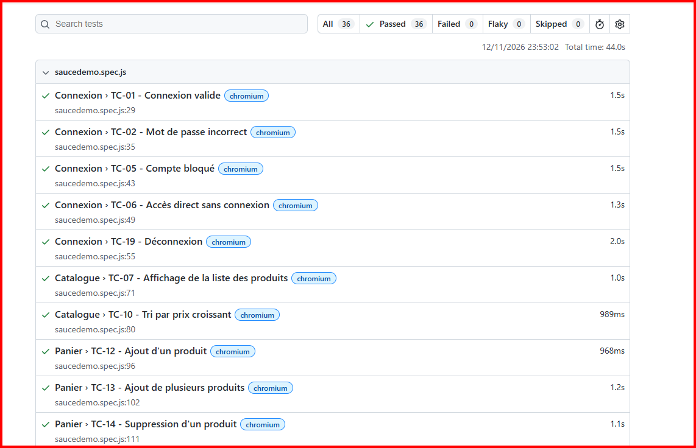

# Tests automatisés – SauceDemo (Playwright)

12 scénarios de non-régression automatisés, issus du plan de tests
(dossier plan-de-tests) : connexion, catalogue, tri, panier, commande.

## Lancer les tests
1. Installer Node.js
2. `npm install`
3. `npx playwright install`
4. `npx playwright test`
5. `npx playwright show-report`

## Choix d'automatisation
Seuls les cas critiques (priorité P1) et stables ont été automatisés.

## Résultats

## Retour d'expérience
Lors de la première exécution, 2 tests (TC-18 et TC-19) échouaient sur WebKit
par dépassement de délai (30 s). L'analyse du rapport a montré que le test
agissait avant que la page ne soit prête. J'ai ajouté des vérifications
d'attente explicites (visibilité du lien de déconnexion, URL de l'étape de
paiement). Après correction : 36 tests sur 36 passés sur Chromium, Firefox et WebKit.
