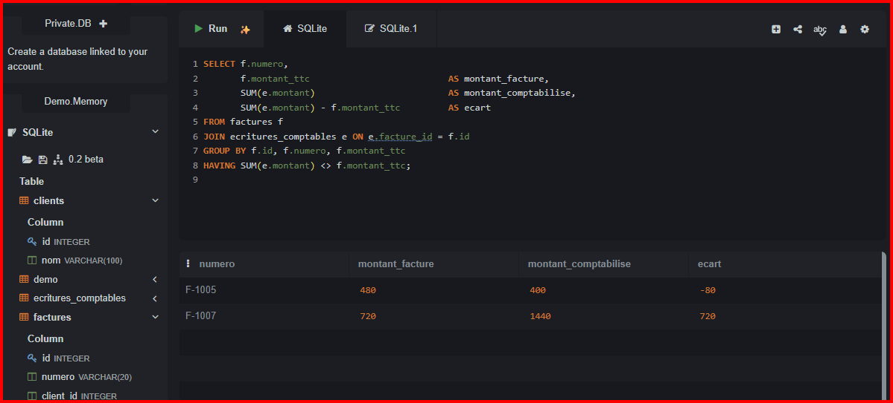
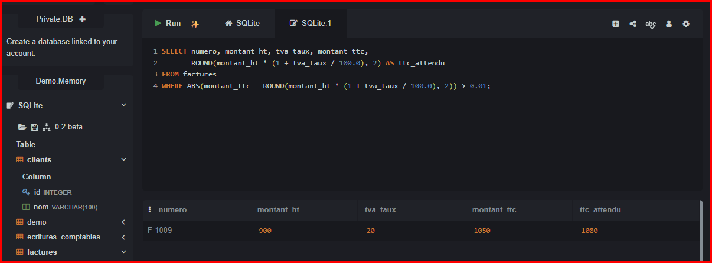

# Contrôles de données SQL : facturation vs comptabilité

Base fictive (clients, factures, écritures comptables) avec anomalies
volontaires, et 7 requêtes de contrôle : factures sans écriture, écarts de
montant, doublons, écritures orphelines, erreurs de calcul du TTC, factures
annulées encore comptabilisées, incohérences de dates.

> Toutes les données sont fictives.

## Utilisation
Exécuter `controle-donnees.sql` dans SQLite, PostgreSQL ou MySQL.

## Exemples de résultats

